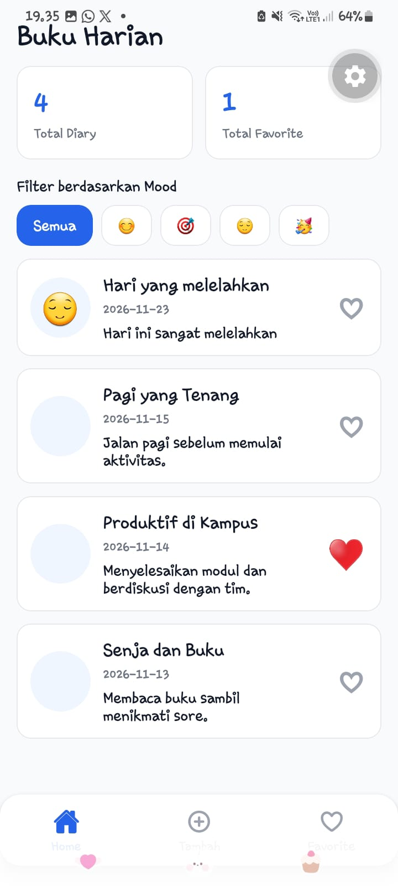
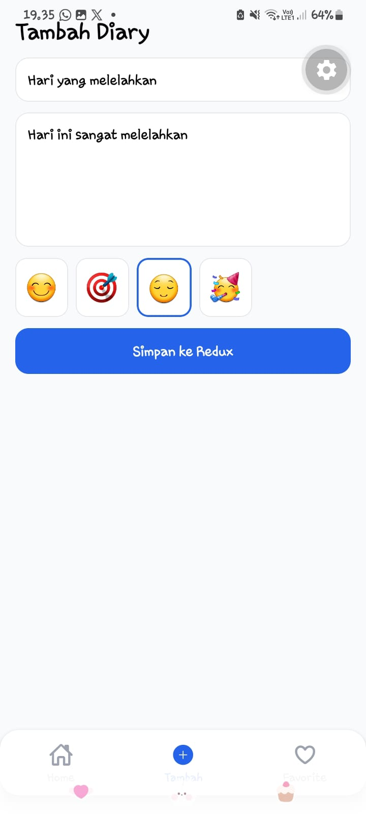
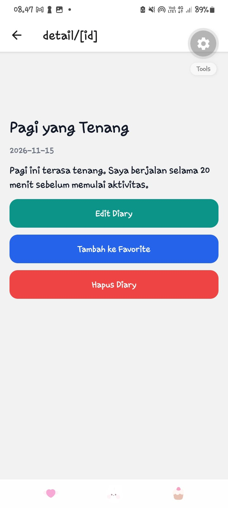
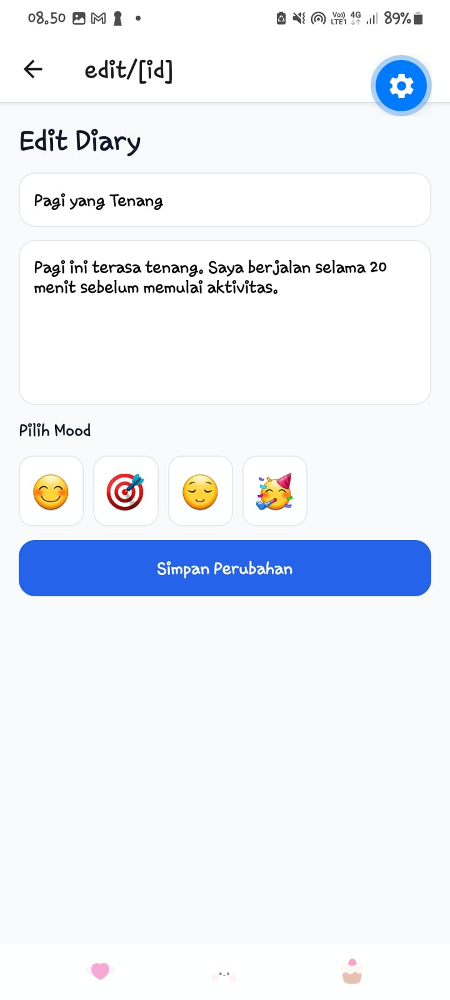
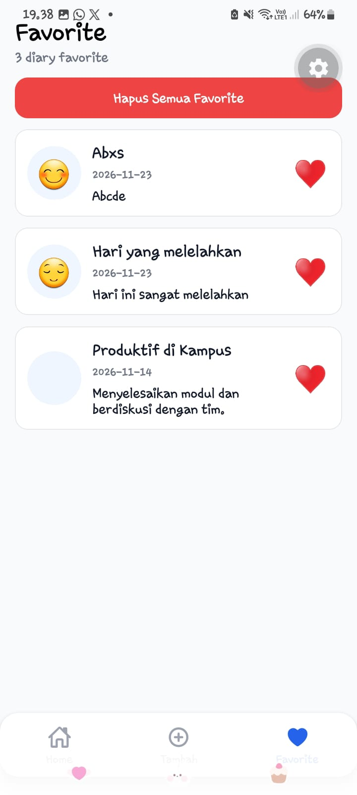
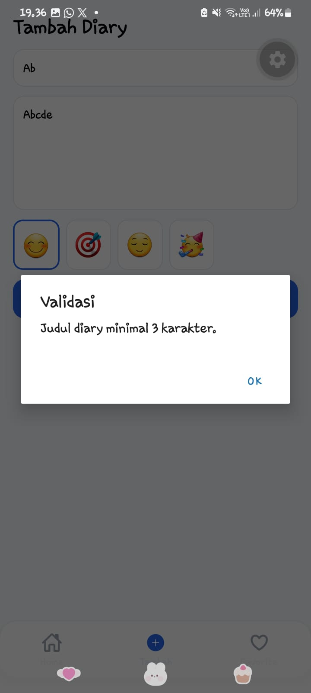
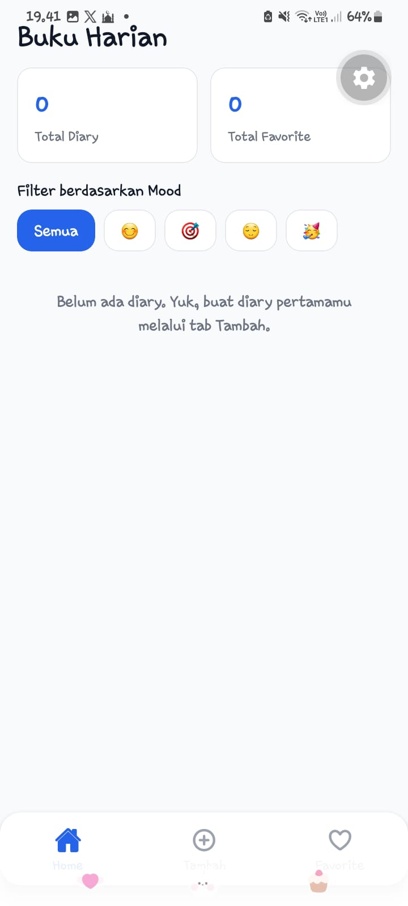

# Diary App - Aplikasi Buku Harian

Aplikasi Buku Harian (Diary App) merupakan aplikasi mobile yang dikembangkan menggunakan React Native dan Redux Toolkit. Aplikasi ini dibuat untuk memenuhi tugas Modul Praktikum 08 pada mata kuliah Mobile Programming.

Aplikasi ini memungkinkan pengguna untuk mencatat aktivitas sehari-hari, mengelola catatan diary, memilih mood, serta menyimpan catatan favorit.

## 📱 Tampilan Aplikasi

### 1. Halaman Home

Halaman Home menampilkan daftar diary yang telah dibuat, statistik jumlah diary dan favorite, serta fitur filter berdasarkan mood.


### 2. Halaman Tambah Diary

Halaman ini digunakan untuk menambahkan catatan diary baru dengan mengisi judul, isi catatan, dan memilih mood.


### 3. Halaman Detail Diary

Halaman Detail menampilkan informasi lengkap dari diary yang dipilih, termasuk judul, tanggal, mood, dan isi catatan.


### 4. Halaman Edit Diary

Fitur Edit Diary digunakan untuk memperbarui judul, isi catatan, dan mood dari diary yang sudah dibuat.


### 5. Halaman Favorite

Halaman Favorite menampilkan daftar diary yang telah ditandai sebagai favorit. Pengguna juga dapat menghapus semua tanda favorite sekaligus.


### 6. Validasi Input

Aplikasi memiliki validasi judul dengan ketentuan minimal tiga karakter. Judul yang tidak memenuhi ketentuan akan ditolak dan menampilkan pesan peringatan.


### 7. Empty State

Aplikasi menampilkan pesan informatif ketika belum terdapat diary atau diary favorit. Pesan juga ditampilkan ketika tidak ditemukan diary berdasarkan mood yang dipilih.


## ✨ Fitur Aplikasi

- Menambahkan diary baru.
- Menampilkan daftar diary.
- Melihat detail diary.
- Mengedit judul, isi, dan mood diary.
- Menghapus diary.
- Menambahkan dan menghapus favorite.
- Menghapus semua favorite sekaligus.
- Memfilter diary berdasarkan mood.
- Menampilkan statistik Total Diary dan Total Favorite.
- Validasi judul minimal tiga karakter.
- Menampilkan empty state pada halaman Home dan Favorite.

## 🛠️ Teknologi yang Digunakan

- **React Native** — Framework untuk membangun aplikasi mobile.
- **Expo** — Platform pengembangan aplikasi React Native.
- **Expo Router** — Pengelolaan navigasi dan halaman aplikasi.
- **Redux Toolkit** — Pengelolaan state aplikasi.
- **React Redux** — Menghubungkan Redux dengan komponen React Native.
- **TypeScript** — Bahasa pemrograman dengan sistem tipe.
- **Ionicons** — Menampilkan ikon navigasi aplikasi.

## 📂 Struktur Folder

```text
diary-app8/
│
├── app/
│   ├── (tabs)/
│   │   ├── _layout.tsx
│   │   ├── index.tsx
│   │   ├── create.tsx
│   │   └── favorites.tsx
│   │
│   ├── detail/
│   │   └── [id].tsx
│   │
│   ├── edit/
│   │   └── [id].tsx
│   │
│   └── _layout.tsx
│
├── src/
│   ├── components/
│   │   └── DiaryCard.tsx
│   │
│   ├── features/
│   │   └── diary/
│   │       └── diarySlice.ts
│   │
│   ├── redux/
│   │   ├── hooks.ts
│   │   └── store.ts
│   │
│   └── styles/
│       └── tokens.ts
│
├── screenshots/
│
├── package.json
└── package-lock.json
```

## 🚀 Cara Menjalankan Aplikasi

Pastikan Node.js sudah terpasang pada komputer.

1. Clone repository:

```bash
git clone https://github.com/revadn-lgtm/diary-app8-tugas8.git
```

2. Masuk ke folder proyek:

```bash
cd diary-app8-tugas8
```

3. Instal dependensi:

```bash
npm install
```

4. Jalankan aplikasi:

```bash
npx expo start
```

5. Buka aplikasi menggunakan Expo Go dengan memindai QR Code yang muncul pada terminal.

## 👩‍💻 Pengembang

**Nama:** Reva Dwi Nurrahma

**NIM:** 2430511041

**Program Studi:** Teknik Informatika

**Universitas:** Universitas Muhammadiyah Sukabumi (UMMI)

**Mata Kuliah:** Mobile Programming

**Modul:** Praktikum 08 - React Redux Toolkit pada React Native

# Diary App - Aplikasi Buku Harian

Aplikasi Buku Harian (Diary App) merupakan aplikasi mobile yang dikembangkan menggunakan React Native dan Redux Toolkit. Aplikasi ini dibuat untuk memenuhi tugas Modul Praktikum 08 pada mata kuliah Mobile Programming.

Aplikasi ini memungkinkan pengguna untuk mencatat aktivitas sehari-hari, mengelola catatan diary, memilih mood, serta menyimpan catatan favorit.

## 📱 Tampilan Aplikasi

### 1. Halaman Home

Halaman Home menampilkan daftar diary yang telah dibuat, statistik jumlah diary dan favorite, serta fitur filter berdasarkan mood.



### 2. Halaman Tambah Diary

Halaman ini digunakan untuk menambahkan catatan diary baru dengan mengisi judul, isi catatan, dan memilih mood.



### 3. Halaman Detail Diary

Halaman Detail menampilkan informasi lengkap dari diary yang dipilih, termasuk judul, tanggal, mood, dan isi catatan.



### 4. Halaman Edit Diary

Fitur Edit Diary digunakan untuk memperbarui judul, isi catatan, dan mood dari diary yang sudah dibuat.



### 5. Halaman Favorite

Halaman Favorite menampilkan daftar diary yang telah ditandai sebagai favorit. Pengguna juga dapat menghapus semua tanda favorite sekaligus.



### 6. Validasi Input

Aplikasi memiliki validasi judul dengan ketentuan minimal tiga karakter. Judul yang tidak memenuhi ketentuan akan ditolak dan menampilkan pesan peringatan.



### 7. Empty State

Aplikasi menampilkan pesan informatif ketika belum terdapat diary atau diary favorit. Pesan juga ditampilkan ketika tidak ditemukan diary berdasarkan mood yang dipilih.




## 🔗 Repository

https://github.com/revadn-lgtm/diary-app8-tugas8